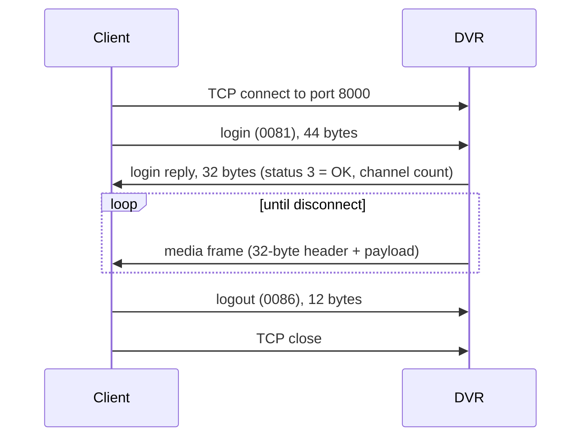

# DVR protocol reference

The network protocol of a family of HiSilicon-based DVRs sold around 2010 under OEM brands (the vendor PC software
names its OEM "Panacom"), as far as it is known. It covers everything the original client software can do, not only
what this bridge uses.

## Sources and confidence

Every fact below comes from one of these sources, marked where it matters:

| mark | source |
|---|---|
| **observed** | packet captures of the original client and test logins against a 4-channel device |
| **static** | static analysis of the client binaries (disassembly, .NET IL), not run |
| **inferred** | a conclusion from the above that was not checked on the wire |

The client binaries:

| file | version | role |
|---|---|---|
| `HiCtrl.ocx` (ProgID `VXCTRL.VxCtrlCtrl.1`, CLSID `{eaf46f27-6268-4353-9c21-7074cdb54e77}`) | 1.0.0.25 (served by the device in `HiActivex.cab`), 1.15.6.0 (vendor PC software) | MFC ActiveX control: protocol, decoding, display, recording to file |
| `PCViewer.exe` | 1.0.0.2 (.NET 3.5) | vendor PC software, a thin UI over `HiCtrl.ocx` |

The analysis used 1.15.6.0. The two versions expose the same protocol on the observed device.

## Device

- Observed on a TechSon DVR558 UN/4: 4 analog PAL inputs, one removable SATA drive bay, front-panel playback and menu
  keys. Other OEM brands of the same platform presumably speak the same protocol. **observed**
- The device serves a web UI with the Boa web server (`Boa/0.94.14rc21`) on TCP 80 and on the media port. The UI only
  installs and drives the ActiveX control; it has no video of its own. **observed**
- The media protocol runs on TCP port 8000 by default, on the same port as the web UI. **observed**
- No RTSP, ONVIF or other open video protocol: a TCP scan of ports 1-10000 found only 80 and 8000, and WS-Discovery
  and `/onvif/device_service` got no answer. **observed**

### Type codes

`/gw/Port.xml` returns the device type in `dMainType` and the channel count in `NUM_CAM`; a view-only account may
read it (it needs only the network monitoring right, p=8). The vendor's PC Viewer knows exactly three type codes:
it compares the string to them to pick the split layouts. **static** (PC Viewer), 504 **observed**

| `dMainType` | channels | platform |
|---|---|---|
| 504 | 4 | "500" series |
| 508 | 8 | "500" series |
| 516 | 16 | "500" series |

The OEM model name (e.g. the brand's own model number) is not on the device. The bridge reports the type as
"DVR 500 series, <n> channels (type <code>)" and uses "DVR 500 series, <n> channels" as the default camera model.

## Conventions

- **Control messages** (login, commands) start with the 4-byte magic `00 00 01 FE` (the little-endian u32
  `0xFE010000`), followed by ASCII hex fields: `%04X` (4 characters) or `%08X` (8 characters), uppercase, no
  separators. The first field after the magic is always the total message length, the second the command code.
- **Media frames** use a binary 32-byte header with little-endian integers.
- One TCP connection carries both directions: control messages from the client, the reply and the media frames from
  the DVR.

## Session



- After a successful login the DVR immediately pushes the live video of all channels, multiplexed, with no further
  request. The first frame of each channel is an IDR frame. **observed**
- The client sends nothing while it only watches: no keepalive message. The original client enables `TCP_NODELAY`,
  `SO_KEEPALIVE` and `SO_LINGER` on the socket. **observed, static**
- The original client connects non-blocking and gives up after 5 s ("No response from server."). **static**
- The original client treats the connection as dead after roughly 45-50 s without received data (it counts 15000
  idle polls of a 0.5 ms `select` plus a 3 ms sleep) and then reconnects. **static, inferred timing**
- Several clients can be logged in at once: two concurrent sessions were observed. The DVR has a limit (login error 1,
  "Too many client"); its value is unknown. **observed**

## Login (`0081`)

Client to DVR, 44 bytes:

| offset | size | content |
|---|---|---|
| 0 | 4 | magic `00 00 01 FE` |
| 4 | 4 | `002C` (length 44) |
| 8 | 4 | `0081` |
| 12 | 32 | MD5(user + password) as uppercase hex; user and password concatenated without a separator |

The user name is not sent in clear, only inside the digest. There is no challenge or nonce, so a captured login can
be replayed: the digest is as sensitive as the password, and the protocol has no encryption. **observed, static**

DVR to client, 32 bytes:

| offset | size | content |
|---|---|---|
| 0 | 4 | magic `00 00 01 FE` |
| 4 | 4 | `0020` (length 32) |
| 8 | 4 | status, `%04X` |
| 12 | 4 | argument, `%04X` |
| 16 | 16 | zero bytes |

| status | meaning | argument |
|---|---|---|
| 1 | not decided yet; the client keeps reading replies | - |
| 2 | login refused | error code |
| 3 | logged in | channel count of the DVR (4 on the observed device) |
| 4 | login refused | error code |

| error code | client message |
|---|---|
| 1 | Too many client. |
| 2 | Incorrect password. |
| 3 | Bad network |
| 4 | Bad Connection , try again !! |
| other | Unkown error. |

A reply without the magic is reported as "LOGIN ERROR". **static** (status 3 and the channel count: **observed**)

## Logout (`0086`)

Client to DVR, 12 bytes: magic + `000C` + `0086`. The original client sends it when it disconnects a logged-in
session. **static**

## Media frames

DVR to client, a 32-byte header followed by the payload. **observed**

| offset | type | content |
|---|---|---|
| 0 | u32 | frame length: header + payload + padding |
| 4 | u32 | payload length without padding |
| 8 | u32 | Unix time in seconds, DVR clock |
| 12 | u8 | `0x0E` video, `0x00` audio |
| 13 | u8 | video: channel index, 0-based |
| 14 | u8 | `0x0F` video, `0x00` audio |
| 15 | u8 | 0 |
| 16 | u32 | timestamp in microseconds, free-running, wraps at 2^32 |
| 20 | u32 | 10003 (`0x2713`) on every frame; meaning unknown |
| 24 | u8 | kind: 0 = H.264 P frame, 1 = audio, 2 = H.264 IDR frame |
| 25 | u8 | 4; meaning unknown |
| 26 | u16 | video: width (352); audio: 256 |
| 28 | u16 | video: height (288); audio: sample rate (16000) |
| 30 | u16 | varies per frame; meaning unknown (not needed to decode) |

The payload is padded with zero bytes to a multiple of 4. The header has no magic, so a reader must stay in sync by
length; a header whose lengths are inconsistent means the stream is lost and the connection should be restarted.

### Video

**observed**

- H.264 Annex-B with 4-byte start codes, Constrained Baseline profile, 352x288 (CIF) on the observed device, which
  streams its sub-stream quality to network clients.
- About 10.7 frames per second per channel; an IDR frame every 1.3 s or so.
- Every IDR payload starts with SPS, PPS and SEI, followed by the IDR slice. P frame payloads hold one slice.
- The VUI timing information in the SPS is wrong (it claims 1200000 fps). Use the header's microsecond timestamp for
  presentation times.
- The 4 channels are interleaved frame by frame in arrival order; each channel's timestamps are monotonic.

### Audio

**observed**

- One audio stream for the whole DVR, not per channel: AAC-LC in ADTS framing, 16 kHz, one ADTS frame per payload,
  about 15.6 frames per second.
- The stream is present even when no microphone is connected (then it carries line noise or silence).

## Commands

Client to DVR. All commands use the conventions above; the table gives the fields after the magic. The packet layouts
are **static**; the meanings come from how the vendor PC software and the web UI call the ActiveX methods, so they
are **inferred** unless marked. None of these is needed for live viewing.

| code | length | fields after the code | ActiveX method | purpose |
|---|---|---|---|---|
| `0081` | 44 | MD5 digest (32 chars) | `ConnectDVR` | login, see above |
| `0085` | 16 | key `%04X` | `SendKeyCommand(key)` | a front-panel key press |
| `0086` | 12 | - | `Disconnect` | logout |
| `0088` | 24 | key low byte `%04X`, key high byte `%04X`, camera `%04X` | `SendKeyXCommand(camera, key)` | PTZ key (pan, tilt, zoom, focus, iris, presets, patrol) |
| `0089` | 32 | 5 x `%04X` | `SendMouseCommand` | a mouse event on the DVR's own on-screen menu |
| `0090` | 24 | 3 x `%04X` | `SendPBFCommand(a, b, c)` | playback control (play, pause, stop, step, speed) and switching between live and playback |
| `0091` | 24 | `%04X`, `%08X` | `SendPlayRecTCommand(a, time)` | seek the playback to a time |
| `0092` | 20 | `%08X` | `GetEventRecordCommand(id)` | query the event (alarm, motion) record list |
| `0093` | 24 | `%04X`, `%08X` | `GetPlayRecbyTime(channels, time)` | search recordings by time |
| `0094` | 16 | `%04X` | `SetSingleScreen(channel)` and others | single-channel view; pause of the live view |

Notes:

- `0085`: key codes `0x0B`-`0x0E` are never sent. The control handles them locally: they choose its own display
  layout (`0x0C` 4-way, `0x0D` 9-way, `0x0E` 16-way split, `0x0B` presumably single view). The web UI uses 12/13/14 to
  show all channels. **static**
- `0088`: the vendor software calls it from its PTZ arrow buttons (8 directions) with the selected camera. Its PTZ
  vocabulary: zoom in/out, focus auto/near/far, iris auto/open/close, patrol, cruise, preset set/call/clear, arrows,
  stop. The key code values per action were not extracted. **static**
- `0090`: the vendor software sends `(a, 255, c)` with a in {0, 1, 3, 4, 5} and c in {0, 1, 2}; 255 likely selects all
  channels and c a speed step. The exact mapping is not known. **static**
- `0091`, `0093`: the 8-character field is a time value (presumably Unix seconds); the vendor software passes 1 and
  255 respectively as the first field. **static, inferred**
- After a playback command, the same connection presumably carries playback frames instead of live ones. The vendor
  software keeps a separate "player" stream type for this. Not verified on the wire. **inferred**

## Client-side functions

The ActiveX control also does work that never reaches the DVR as a separate command, all **static**:

- decoding and display (DirectDraw), single and split layouts;
- recording the received stream to a proprietary `.pvf` file (`StartPVFBackupPath`, the "backup" of the vendor
  software) and playing such files back (`OpenPVFFile`, `SeekPVF`);
- converting to AVI (`SaveAvi`, `StartToCaptureAVI`) and snapshots to BMP (`StillCapture`);
- volume, mute and audio channel selection.

The full ActiveX method list (90 methods) is in the appendix.

## DDNS lookup

`ConnectViaDDns` first asks a DDNS server (address and port given by the caller, the `DDnsIP` and `DDnsPort` values)
for the DVR's address. The request and the reply start with the little-endian u32 `0xAA55AA55` (bytes
`55 AA 55 AA`); the reply then carries an IPv4 address, which the control connects to as usual. The DDNS service of
the vendor is long gone; details beyond the magic were not traced. **static**

## Unused "iCAM24" interface

37 methods of the control (`iCAM24Login`, `GetFirmwareVer`, `GetHddTemperature`, `GetHddVolume`, `GetFanStatus`,
`GetEventList`, `PTZControl`, `GetConfiguration`, `SetConfiguration` and others) look like device management, but are
development leftovers: each first pops up a message box ("sendCms2Dr"), then sends a text message in a different
framing:

```
55 AA <n> AA 55  <method name> 00 <arg 1> 00 ... 00 55 AA 00 00  <100 x 'A'>
```

where `n` is the number of strings. The vendor software never calls them, and the observed device presumably does not
implement them. **static**

## Web interface

The Boa web UI is a set of static pages plus XML endpoints, used by the browser page that hosts the control. From the
device's own JavaScript: **static** (served pages and status codes: **observed**)

| endpoint | use |
|---|---|
| `/gw/Port.xml` | media port in `<p2>` (empty: use the web port; `-1`: no service) and UI language in `<lang>`; without a query string it answers `<r>11</r>` (see "Web settings API") |
| `/gw/perm.xml?p=N` | `<p>0</p>` or `<p>1</p>`: whether the user has permission N (7: configuration, 8: network monitoring) |
| `/gw/PTZI.xml` | PTZ information |
| `index_web.html`, `ChannelSetup.html`, `EventForm.html` | configuration and event search pages |
| `HiActivex.cab` | the ActiveX control (version 1.0.0.25) |

The pages authenticate with a cookie `account=<base64(user:password)>`, again without any protection.

## Web settings API

The settings pages of the web UI read and write the DVR configuration through `/gw/*.xml` endpoints. The facts in
this list were observed on the device with an administrator and a view-only account; the field table below is
derived from the device's static pages and their English language file (**static**, unless a row says otherwise).

- **Authentication:** the cookie `account=<base64(user:password)>` on every request; there is no session and no login
  request. A wrong password is not an error by itself: it simply grants no right.
- **Query string required:** every `/gw/*.xml` request needs a non-empty query string (the pages' jQuery adds
  `_=<milliseconds>`); without one the DVR answers `<r>11</r>`.
- **Replies:** a flat XML record, `<r><field>value</field>...</r>`, each one including `lang`; or only a status code,
  `<r>N</r>`: `11` no query string, `30` permission denied, `20` seen from EventTime.xml (meaning unknown).
- **Rights:** `/gw/perm.xml?p=N` answers `<r><p>0</p></r>` or `<r><p>1</p></r>`. The administrator had p=0..8 (and the
  UI checks p=9 for PTZ); the view-only account only p=8 (network monitoring). The meaning of each N is in the table
  under "Rights".
- **Endpoints:** crawling the static pages finds 39. Readers: `Port`, `View`, `Network`, `SysComm`, `Screen`,
  `Audio`, `DateTime`, `Key`, `PTZI`, `CgiAuth`, and per channel `ChannSet`, `RecSet`, `Alert`, `Mot`, `MotArea`,
  `PTZ`, `Schedule`, `Sensor`; plus `EventGet` and `EventTime` for the event search. Writers: the reader's name plus
  `A` (`ViewA.xml`, `NetworkA.xml`, `ChannSetA.xml?ch=...`), a GET with the form fields as query parameters.
- **Actions, not settings:** `CgiAddUser`, `CgiDelUser` (account management), `NTPClient` (starts an NTP
  synchronization) and `AutoADJ` (the record setup's "auto settings", called with `ch`, `resol`, `video`, `frame`;
  its side effects are unclear). Tools must not call them as part of reading or writing settings.
- **Channels:** per-channel pages take `ch=1..4` (1-based); `ch=0` returns an empty or zero record, probably the
  placeholder behind the UI's "all" option.
- **Write semantics:** the page's form always submits its full field set, so a client changing one field sends every
  other field with its current value. Fields the form disables are left out by the browser (see the open questions).
- **On-screen display only:** the View.xml fields (`mgm`, `dynef`, `icoh`, `erri`, `all`, `recl`, `net`, `hard`,
  `date`, `rota`, `chall`, `chnum`, `chn`, `crecl`, `cvl`, `crm`, `cdm`, `cav`) affect the DVR's own monitor output; the
  network stream carries no overlay even with all of them on.
- **Recording vs. network stream:** a channel recorded at `frame=25` (RecSet.xml) was streamed over the network at
  about 10.7 fps; Network.xml `vq` (network video quality) was 2, Standard.
- **Secrets in clear text:** CgiAuth.xml returns every account's password (`p<i>`) next to its name (`u<i>`) and its
  27-character permission string (`flag<i>`); Network.xml returns the PPPoE, DDNS, mail and CMS passwords. A client
  must never display or log them.

### Conventions of the pages

- Read: the page calls `GET /gw/<Page>.xml` with jQuery `cache: false` (adds `_=<ms>`), plus `ch=` on per-channel pages.
  Every reply carries `lang` (0..11, the UI language, see SystemCommon `lang`; observed on the device).
- Write: the page's form does `GET /gw/<Page>A.xml` with its named fields (jQuery form plugin, `ajaxForm`).
- Disabled controls: the form plugin skips disabled fields (standard plugin behavior; the plugin file was not saved, so
  inferred). Fields marked "disabled" below are therefore not in the UI's write request in that state. Whether the
  device needs them is an open question.
- Per-channel pages: channel tabs send `ch=all` or `ch=1..N`. The index is 1-based (`Init(1)` .. `Init(4)`, more tabs
  up to N added from the `totalch` cookie or the viewer's channel count; 9 is treated as 8). Observed on the device:
  ch=1..4 return the channels, ch=0 returns an empty or zero record.
- `ch=all` mode: a field whose value differs between channels is read as `255`; the UI then shows an extra option
  `255 = -` and submits 255 if left untouched (inferred meaning: keep each channel's own value).
- Label resolution: the page binds `<span id="LANx">` / option classes to `dStr*` keys in `InitLang()`; the English
  text below is from `English.js`. "(literal)" = text hardcoded in the HTML, no key.

### Pages

| HTML page | menu title (English) | read URL(s) | write URL | per-channel | perm gate |
|---|---|---|---|---|---|
| root.html | main viewer (login, live view, toolbar) | Port.xml (`lang`, `p2` = monitor port, -1 = off); perm.xml?p=5/7/8/9; PTZI.xml (`chmask`) | none | no | p=8 live view (0 -> "account not have authority"); p=7 shows the Config button that opens the settings window (`index_web.html`; a reply of 2 -> "Network Management Service Disable"); p=5 shows Search; p=9 plus PTZI `chmask` != 0 shows PTZ |
| index_web.html | settings window (frameset: Top / Left / 0.html / ChannelSetup.html) | perm.xml?p=7 (on frameset load) | none | no | p=7: if 1, loads 0.html in the right frame and ChannelSetup.html in the main frame; otherwise blanks the top, left and main frames with 0.html |
| 0.html | blank placeholder page (empty body) | none | none | no | - |
| EventForm.html | Search window (tabs Time Search / Event Search) | EventGet.xml (see its section); EventTime.xml only in a comment | none | no | none on the page; root.html opens it only after p=5 |
| Left.html | settings left menu | Port.xml; perm.xml?p=0 | none | no | p=0: if not 1, removes Authentication Setup (and Utility/Tools, already commented out) |
| Top.html | banner | none (script commented out) | none | no | unknown |
| menuDetectorSetup.html | Detector Setup submenu: Alarm Setup / Motion Setup / Sensor Setup | Port.xml | none | no | unknown |
| menuSystemSetup.html | System Setup submenu: System Setup / View Setup / Date/Time Setup | Port.xml | none | no | unknown |
| menuHardwareSetup.html | Hardware Setup submenu: Network / Screen / Keyboard/PTZ / Audio Setup | Port.xml | none | no | unknown |
| ChannelSetup.html | Channel Setup | ChannSet.xml?ch= | ChannSetA.xml | yes (all, 1..N) | p=7 (settings window only; page has no own check) |
| RecordSetup.html | Record Setup | RecSet.xml?ch=; action AutoADJ.xml?ch=&resol=&video=&frame= | RecSetA.xml | yes (all, 1..N) | p=7 (window) |
| RecordSchedule.html | Record Schedule | Schedule.xml?ch= | ScheduleA.xml | yes (all, 1..N) | p=7 (window) |
| AlertSetup.html | Detector Setup > Alarm Setup | Alert.xml?ch= | AlertA.xml | yes (all, 1..N) | p=7 (window) |
| MotionSetup.html | Detector Setup > Motion Setup | Mot.xml?ch=; MotArea.xml?ch= (UI code disabled, but answers on the device) | MotA.xml (MotAreaA.xml only in disabled code) | yes (all, 1..N) | p=7 (window) |
| SensorSetup.html | Detector Setup > Sensor Setup | Sensor.xml?ch= | SensorA.xml | yes (1..N, no "all") | p=7 (window) |
| AuthSetup.html | Authentication Setup | CgiAuth.xml; perm.xml?p=0; actions CgiAddUser.xml, CgiDelUser.xml?UserIndex=i | CgiAuthA.xml | no | p=0 (page redirects away if not 1) and p=7 (window) |
| SystemCommon.html | System Setup (language, sequence, beep, input devices, auto exit) | SysComm.xml | SysCommA.xml | no | p=7 (window) |
| ViewSetup.html | System Setup > View Setup | View.xml | ViewA.xml | no | p=7 (window) |
| DateTimeSetup.html | System Setup > Date/Time Setup | DateTime.xml; action NTPClient.xml | DateTimeA.xml | no | p=7 (window) |
| NetworkSetup.html | Hardware Setup > Network Setup | Network.xml | NetworkA.xml | no | p=7 (window) |
| ScreenSetup.html | Hardware Setup > Screen Setup | Screen.xml | ScreenA.xml | no | p=7 (window) |
| KeyPTZsetup.html | Hardware Setup > Keyboard/PTZ Setup | Key.xml | KeyA.xml | no | p=7 (window) |
| PanTiltZoomSetup.html | Hardware Setup > Keyboard/PTZ Setup > Pan/Tilt/Zoom Setup | PTZ.xml?ch= | PTZA.xml | yes (all, 1..N) | p=7 (window) |
| AudioSetup.html | Hardware Setup > Audio Setup | Audio.xml?ch=1 | AudioA.xml | fixed ch=1, no tabs | p=7 (window) |
| SpecialTool.html | Utility/Tools (menu entry commented out) | RecSet.xml (only for `lang`) | none | no | p=0 (Left menu removes it), p=7 |
| HardwareSetup.html, SystemSetup.html, QueryErrorMessage.html, login.html | - | saved copies are HTTP 404 pages; the crawl also lists login.html, logout.html, QueryErrorMessage.html as missing | - | - | - |

perm.xml index meaning (from the account flag layout on AuthSetup, inferred; consistent with the device answers seen
for an admin (p=0..8 = 1) and a view-only account (only p=8 = 1), and with root.html's use of p=5/7/9):

| p | right (English label, key) |
|---|---|
| 0 | System Management (dStrSecuritySetup_SysManagement) |
| 1 | Stop Recording (dStrSecuritySetup_StopRecording) |
| 2 | Enter Main Menu (dStrSecuritySetup_IntoMainMenu) |
| 3 | Enter Play Menu (dStrSecuritySetup_IntoPlayMenu) |
| 4 | not in the UI (written as `-`); possibly Archive Events (dStrSecuritySetup_ArchiveEvent), inferred |
| 5 | Event Inquiry (dStrSecuritySetup_EventSearch); root.html gates the Search button with it |
| 6 | Data Backup (dStrSecuritySetup_DataBackup) |
| 7 | Network Management (dStrSecuritySetup_NetManagement); root.html gates the settings window with it |
| 8 | Network Monitoring (dStrSecuritySetup_NetMonitoring); root.html gates live view with it |
| 9 | Pan/Tilt/Zoom Control (dStrSecuritySetup_PanTiltCtrl); root.html gates the PTZ button with it |

### Fields per page

#### ChannelSetup.html (ChannSet.xml / ChannSetA.xml)

| field | English label (key) | type | values | notes |
|---|---|---|---|---|
| ch | Channel Number (dStrChnSetup_ChnNumber) | hidden | all, 1..N | set by the channel tabs |
| act | Active Channel (dStrChnSetup_ChnActive) | select | 1=ON, 0=OFF | 255=- in ch=all |
| rec | Record Channel (dStrChnSetup_ChnRecord) | select | 1=ON, 0=OFF | 255=- in ch=all |
| name | Channel Name (dStrChnSetup_ChnName) | text, max 24 | free text, ASCII only | keypress filter drops chars >= 128, CheckName clears CJK input; disabled when ch=all, so not submitted then (inferred) |
| hidd | Hidden Channel (dStrChnSetup_ChnHidden) | select | 0=NO, 1=YES | 255=- in ch=all |
| rota | Rotation Time (dStrChnSetup_SequenceTime) | select | 2..30 (value = shown number) | unit seconds, inferred |
| bri, contra, hue, satur, sharp | Brightness, Contrast, Hue, Saturation, Sharpness (dStrChnSetup_Brightness / _Contrast / _Hue / _Saturation / _Sharpness) | select | bri 1..20, contra 1..20, hue 1..32, satur 1..32, sharp 1..16 | section Standard Color Adjustment (dStrChnSetup_StdColorAdjustment) |
| stc | Activate Special Color (dStrChnSetup_ActiveSpecialColor) | select | 1=Enable, 0=Disable | section Special Color Adjustment (dStrChnSetup_SpcColorAdjustment) |
| sStart | Start Time (dStrBackupMenu_StartTime) | hidden, set by JS on Apply | 0..143 = hour*6 + ten-minute index | built from two unnamed selects: hour 0..23, minute 0..5 (= :00, :10 .. :50); 255 = differ in ch=all, but the Apply handler then computes 255*6+255 = 1785 (JS bug) |
| sEnd | End Time (dStrBackupMenu_EndTime) | hidden, set by JS | same as sStart | same 1785 issue |
| sBri, sContra, sHue, sSatur, sSharp | Brightness, Contrast, Hue, Saturation, Sharpness (same keys) | select | same ranges as bri .. sharp | special color values, used between sStart and sEnd when stc=1 (inferred) |

#### RecordSetup.html (RecSet.xml / RecSetA.xml)

| field | English label (key) | type | values | notes |
|---|---|---|---|---|
| ar | Auto Record (dStrRecSetup_AutoRecord) | select | 0=OFF, 1..6 = 10..60 Sec (value*10) | above the channel section, so global (inferred); still submitted with ch |
| pgu | Activate Performance Gains (dStrRecSetup_ActiveGains) | select | 0=Disable, 1=Enable | global (inferred); 0 disables `perf` |
| resol | Record Resolution (dStrRecSetup_RecordResolution) | select | 1=Low Res (CIF), 2=Middle Res (Half D1), 3=High Res (D1) | 255=- in ch=all |
| video | Video Quality (dStrRecSetup_VideoQuality) | select | 0=Lowest, 1=Low, 2=Standard, 3=High, 4=Highest | 255=- in ch=all |
| frame | Record Framerate (dStrRecSetup_RecordFramerate) | select, built by JS | 1..30 when read `fvk`=0 (NTSC), else 1..25 (PAL) | unit FPS, inferred; 255=- in ch=all |
| perf | Record Performance Gains (dStrRecSetup_PerformanceGains) | select | 1=YES, 0=NO | disabled (not submitted) when pgu=0; 255=- in ch=all |
| ch | Channel Number (dStrChnSetup_ChnNumber) | hidden | all, 1..N | |
| fvk | - | read only | 0 = NTSC (30 fps), other = PAL (25 fps) | drives the `frame` list |
| rdlt | Max. Recording Days (dStrRecSetup_DataLimitedDays) | - | ? | commented out in the HTML; neither read nor submitted |

Action "Auto Settings Adjustment" (dStrRecSetup_AutoSettings): `GET /gw/AutoADJ.xml?ch=&resol=&video=&frame=` with the
current selections, then the page re-reads RecSet.xml. Inferred: the device fits the settings to its recording budget.

#### RecordSchedule.html (Schedule.xml / ScheduleA.xml)

| field | English label (key) | type | values | notes |
|---|---|---|---|---|
| ch | Channel Number (dStrChnSetup_ChnNumber) | hidden | all, 1..N | |
| day0..day6 | Sunday..Saturday (dStrWeekDay_Sunday .. dStrWeekDay_Saturday) | hidden, 24 chars | one char per hour 0..23: 0=None (dStrEvt_None, no recording), 1=Time (dStrEvt_Time), 2=Motion (dStrEvt_Motion), 3=Sensor (dStrEvt_Sensor), 4=Motion & Sensor | HTML default is 24 x `1`; a read value `9` is drawn as an empty cell (meaning ?, perhaps channels differ in ch=all, inferred) |

The mode radio (`mode`, label Select Mode, dStr_SelectMode) is outside the form and not submitted. JS bug: the
"Day\Hour" corner (SetAll) does not reset its string per day, so day1..day6 get 48..168 chars; device handling ?.

#### AlertSetup.html - Detector Setup > Alarm Setup (Alert.xml / AlertA.xml)

| field | English label (key) | type | values | notes |
|---|---|---|---|---|
| ch | Channel Number (dStrChnSetup_ChnNumber) | hidden | all, 1..N | |
| ndm | Light Detect Mode (dStrDetectorSetup_LightDetect) | select | 0=Sensitivity OFF, 1=Sensitivity Low, 2=Sensitivity Normal, 3=Sensitivity High, 4=Sensitivity Highest | 255=- in ch=all |
| nda | Light Detect Alarm Mode (dStrDetectorSetup_LightAlarm) | select | 0=Mute, 1=Buzzer-Short, 2=Buzzer-Long, 3=Alarm-Short, 4=Alarm-Long | "Alarm" = External Alarm output (dStr_Alarm), "Buzzer" = Buzzer Alarm (dStr_Buzzer) |
| bdm | Blind Detect Mode (dStrDetectorSetup_BlindDetect) | select | same as ndm | |
| bda | Blind Detect Alarm Mode (dStrDetectorSetup_BlindAlarm) | select | same as nda | |
| vlm | Video Loss Mode (dStrDetectorSetup_VideoLoss) | select | 0=OFF, 1=ON | |
| vla | Video Loss Alarm Mode (dStrDetectorSetup_VLossAlarm) | select | same as nda | |
| anf | External Notification (dStrDetectorSetup_Notification) | - | ? | commented out; neither read nor submitted |

#### MotionSetup.html - Detector Setup > Motion Setup (Mot.xml / MotA.xml)

| field | English label (key) | type | values | notes |
|---|---|---|---|---|
| ch | Channel Number (dStrChnSetup_ChnNumber) | hidden | all, 1..N | |
| rda | Record Detection Activate (dStrDetectorSetup_RecordDetect) | select | 0=Disable, 1=Enable | 255=- in ch=all |
| motm | Motion Mode (dStrDetectorSetup_MotionMode) | select | 0=Sensitivity OFF .. 4=Sensitivity Highest (as ndm) | |
| motrt | Record Time (dStrDetectorSetup_RecordTime) | select | 0=5, 1=10, 2=15, 3=20, 4=25, 5=30, 6=45, 7=60, 8=90, 9=120, 10=150, 11=180 Sec | value is an index, not seconds |
| motam | Alarm Mode (dStrDetectorSetup_AlarmMode) | select | 0=Mute, 1=Buzzer-Short, 2=Buzzer-Long, 3=Alarm-Short, 4=Alarm-Long | |
| motat | Alarm Time (dStrDetectorSetup_AlarmTime) | select | 0=Nonstop, 1..12 = 5..60 Sec (value*5) | |
| motdt | Trigger Full Screen (dStrDetectorSetup_TriggerTime) | select | 0=OFF, 1..30 = 1..30 Sec | |
| mottt | Trigger Type (dStrDetectorSetup_TriggerType) | select | 0=Initial Trigger, 1=Continuous Trigger | |
| moten | External Notification (dStrDetectorSetup_Notification) | read only | ? (255=- handled) | select commented out; read but not submitted |

Motion area: the UI code for Motion Area Setup (dStrDetectorSetup_MotionArea) is disabled, but `MotArea.xml?ch=`
does answer on the device, with `X`, `Y`, `XL`, `YL`. The disabled code writes `MotAreaA.xml?ch=&X=&Y=&XL=&YL=`
(untested): one rectangle in a 330 x 270 pixel canvas (a source comment says 22 x 18 cells of 15 px, so the values are
probably pixels of that canvas, inferred). Hidden `DivFlag`, `x1`, `y1`, `x2`, `y2` are outside the form.

#### SensorSetup.html - Detector Setup > Sensor Setup (Sensor.xml / SensorA.xml)

| field | English label (key) | type | values | notes |
|---|---|---|---|---|
| ch | Channel Number (dStrChnSetup_ChnNumber) | hidden | 1..N (no "all" tab; HTML default 1) | the "all" code path exists in JS but no tab sends it |
| rda | Record Detection Activate (dStrDetectorSetup_RecordDetect) | select | 0=Disable, 1=Enable | |
| sem | Sensor Mode (dStrDetectorSetup_SensorMode) | select | 0=Disable, 1=Enable | |
| sm1..sm4 | Sensor Mapping (dStrDetectorSetup_SensorMapping), inputs 1..4 | select | 0=Not installed, 1=Normal-Open, 2=Normal-Close | option keys dStrFirmUpdate_NotInstalled, dStr_NormalOpen, dStr_NormalClose; which inputs trigger this channel, inferred |
| sert | Record Time (dStrDetectorSetup_RecordTime) | select | same index table as motrt (5..180 Sec) | |
| seam | Alarm Mode (dStrDetectorSetup_AlarmMode) | select | same as motam | |
| seat | Alarm Time (dStrDetectorSetup_AlarmTime) | select | same as motat | |
| setd | Trigger Full Screen (dStrDetectorSetup_TriggerTime) | select | same as motdt | |
| sett | Trigger Type (dStrDetectorSetup_TriggerType) | select | same as mottt | |
| seen | External Notification (dStrDetectorSetup_Notification) | read only | ? | select commented out; read but not submitted |

#### AuthSetup.html - Authentication Setup (CgiAuth.xml / CgiAuthA.xml)

Rows are built by JS per account i = 0..uc-1; account 0 is the admin (cannot be deleted, no expiry). Visible
controls have no `name`; on Apply the JS copies them into hidden fields.

| field | English label (key) | type | values | notes |
|---|---|---|---|---|
| uc | - | hidden | number of accounts | read from CgiAuth.xml `uc` |
| usr0..usr(uc-1) | Account ID (dStrSecuritySetup_AccountID) | hidden (from text input, max 10) | free text | duplicate names are rejected client side; CheckName clears CJK input |
| pw0..pw(uc-1) | Passwd (dStrSecuritySetup_AccountPW) | hidden (from a plain text input, max 6) | free text | password - secret; read back in clear as `p<i>` in CgiAuth.xml |
| flag0..flag(uc-1) | rights, see below | hidden, built by JS | see flag format | |
| dt0..dt(uc-1) | Expiration Date (dStrSecuritySetup_ExpiredDate) | hidden, built by JS | Unix seconds of the chosen date (year 2010..2038, month, day) | meaningless when the expiry bit is 0 |

Read values in CgiAuth.xml: `uc`, `u<i>` (name), `p<i>` (password, secret), `flag<i>`.

Flag format written by the UI (13 chars + decimal): positions 0..3 = rights p0..p3, `-`, positions 5..9 = rights p5..p9,
`-`, position 11 = Activate Account (dStrSecuritySetup_ActiveAccount), position 12 = Activate Expiration Date
(dStrSecuritySetup_ActiveExpired), then a decimal bitmask of channels whose video is NOT allowed (bit k = channel
k+1; column Video Monitoring, dStrSecuritySetup_VideoMonitor). Each right char is 1/0 (checkbox). The read parser
instead takes the channel mask as 4 hex digits after the first `-` and the expiry as hex Unix seconds after `,`, so
the read format differs from the written one (see open questions).

Actions: Create (dStrSecuritySetup_CreateAccount) = `GET /gw/CgiAddUser.xml`; Delete (dStrSecuritySetup_DeleteAccount)
= `GET /gw/CgiDelUser.xml?UserIndex=<i>` (not for i=0). Option (dStrSecuritySetup_SettingSwitch) only switches the
visible column group.

#### SystemCommon.html - System Setup (SysComm.xml / SysCommA.xml)

| field | English label (key) | type | values | notes |
|---|---|---|---|---|
| lang | Language Selection (dStrSysSetup_LanguageSelection) | select | 0=English, 1=Chinese, 2=Spanish, 3=Russian, 4=Persian, 5=German, 6=Greek, 7=Thai, 8=Hungarian, 9=Italian, 10=Japanese, 11=French | option text is in each language; English names from LoadLang(); after Apply the frames reload |
| beepm (control id `ssf`) | Full Screen Sequence (dStrSeqSetup_FullScreenSequence) | select | 0=OFF, 1=ON | HTML bug: named `beepm`, so its value is sent as a first `beepm` and the read field `ssf` is never written |
| ss4 | 4 Split Sequence (dStrSeqSetup_4SplitSequence) | select | 0=OFF, 1..29 = 2..30 Sec (value+1) | section Sequence Setup (dStrSysSetup_SequenceSetup) |
| ss8 | 1+7 Split Sequence (dStrSeqSetup_8SplitSequence) | select | same as ss4 | |
| ss9 | 9 Split Sequence (dStrSeqSetup_9SplitSequence) | select | same as ss4 | |
| beepm | Beep of Mouse Buttons (dStrBuzzerSetup_MouseButtons) | select | 0=Mute, 1=Sound A, 2=Sound B, 3=Sound C | second `beepm` in the request (see above); section Button Beep Setup (dStrSysSetup_ButtonBeepSetup) |
| beepk | Beep of Keypad (dStrBuzzerSetup_Keypad) | select | same as beepm | |
| beepi | Beep of IR Remote (dStrBuzzerSetup_IrRemote) | select | same as beepm | |
| mms | Mouse Moving Speed (dStrInputSetup_MouseMoveSpeed) | select | 1=Slow, 2=Normal, 3=Fast | section Input Device Setup (dStrSysSetup_InputDeviceSetup) |
| mrs | Mouse Repeat Speed (dStrInputSetup_MouseRepSpeed) | select | 0=OFF, 1=Slow, 2=Normal, 3=Fast | |
| krs | Keypad Repeat Speed (dStrInputSetup_KeypadRepSpeed) | select | same as mrs | |
| irs | IR Repeat Speed (dStrInputSetup_IrRepSpeed) | select | same as mrs | |
| auto | Auto Exit Menu (dStrSysSetup_AutoExitMenu) | select | 0=OFF, 1..6 = 10..60 | unit seconds, inferred |
| ssf | (Full Screen Sequence) | read only | 0/1 | see the `beepm` naming bug |

#### ViewSetup.html - System Setup > View Setup (View.xml / ViewA.xml)

All fields: select, 0=OFF, 1=ON. Observed on the device: they only affect the DVR's own monitor output, not the
network stream.

| field | English label (key) | notes |
|---|---|---|
| mgm | Main Menu Graphics Mode (dStrViewSetup_MainMenuGraphics) | section System Display Setup (dStrViewSetup_SystemDisplay) |
| dynef | Channel Dynamic Effects (dStrViewSetup_ChannelEffects) | |
| icoh | Icons Help (dStrViewSetup_IconHelp) | |
| erri | Error Messages (dStrViewSetup_ErrorMessage) | |
| all | All State Bar Information (dStrViewSetup_AllStateInfo) | section State Bar Information (dStrViewSetup_StateInfo) |
| srecl | Record Light (dStrViewSetup_RecordLed) | state bar record light; the form submits `srecl`, but View.xml returns it as `recl` (observed on the device), so the page's own read (`$("srecl", xml)`) finds nothing |
| net | Network Information (dStrViewSetup_NetworkInfo) | |
| hard | Hard Drive Information (dStrViewSetup_HardDriveInfo) | |
| date | Date/Time Information (dStrViewSetup_TimeInfo) | |
| rota | Rotate Information (dStrViewSetup_SequenceInfo) | |
| chall | All Channels Information (dStrViewSetup_AllChannelInfo) | section Channel Information (dStrViewSetup_ChannelInfo) |
| chnum | Channel Number (dStrViewSetup_ChannelNumber) | |
| chn | Channel Name (dStrViewSetup_ChannelName) | |
| crecl | Record Light (dStrViewSetup_RecordLed) | per-channel overlay record light |
| cvl | Video Loss (dStrViewSetup_VideoLoss) | |
| crm | Record Mode (dStrViewSetup_RecordMode) | |
| cdm | Detector Mode (dStrViewSetup_DetectorMode) | |
| cav | Alarm Display (dStrViewSetup_AlarmView) | |

#### DateTimeSetup.html - System Setup > Date/Time Setup (DateTime.xml / DateTimeA.xml)

| field | English label (key) | type | values | notes |
|---|---|---|---|---|
| mode | Date Display Mode (dStrTimeSetup_DateViewMode) | select | 0=YYYY/MM/DD, 1=DD/MM/YYYY, 2=MM/DD/YYYY | |
| zone | Time Zone (dStrTimeSetup_TimeZone) | select, built by JS | 0..len-1 = "GMT+h:mm <name>" rows of `TimeZoneMap` | list is in TZMAP.js (not saved), so the index-to-zone map is ?; changing it auto-fills the DST fields from that table |
| dlact | Activate Daylight Saving (dStrTimeSetup_DaylightActive) | select | 0=Disable, 1=Enable | section Daylight Saving Time (dStrTimeSetup_Daylight) |
| smon | Time Starts (dStrTimeSetup_DaylightStart): Month (dStr_Month) | select | 0=No Definition, 1..12 = January..December | |
| sweek | Time Starts: Week (dStr_Week) | select | 0=No Definition, 1=First Week, 2=Second Week, 3=Third Week, 4=Fourth Week, 5=Last Week | |
| swday | Time Starts: Day (dStr_Day) | select | 0=No Definition, 1=Sunday .. 7=Saturday | |
| shour | Time Starts: Hour (dStr_Hour) | select | 0..23 | |
| emon, eweek, ewday, ehour | Time Ends (dStrTimeSetup_DaylightEnd): Month, Week, Day, Hour | select | same as smon, sweek, swday, shour | |
| ntp | Activate Service (dStrTimeSetup_NTPActive) | select | 0=Disable, 1=Enable | section NTP Server (dStrTimeSetup_NTPServer) |
| server | Server IP (dStrTimeSetup_NTPServerIP) | text, no max length | host name or IPv4 | chars other than `.0-9A-Za-z` clear the field |
| inter | Interval (Days) (dStrTimeSetup_NTPGapDays) | select | 1..7 = 1..7 Day | |
| DvrUtcTime | - | hidden | always 0 from the UI | the line that would set it from the read `utc` is commented out |
| utc | Time Set (dStrTimeSetup_TimeSet) | read only | DVR clock, Unix seconds | shown as a running clock |

Action "Synchronize Now" (dStrTimeSetup_NTPSyncNow): `GET /gw/NTPClient.xml` (no parameters besides `_`); the page
then always alerts "NTP Synchronize OK".

#### NetworkSetup.html - Hardware Setup > Network Setup (Network.xml / NetworkA.xml)

| field | English label (key) | type | values | notes |
|---|---|---|---|---|
| act | Network Enable (dStrNetworkSetup_NetworkActive) | select | 0=Disable, 1=Enable | |
| ipt | IP Type (dStrIPAddrSetup_IPMode) | select | 0=Static, 1=DHCP, 2=PPPoE | shows the matching address block; section IP Address Setup (dStrNetworkSetup_IPSetup) |
| sip0..sip3 | IP Address (dStrIPAddrSetup_IPAddress), static | text, max 3 each | IPv4 octets | digits only (checkNum on IE propertychange) |
| sgw0..sgw3 | Gateway (dStrIPAddrSetup_Gateway), static | text, max 3 each | IPv4 octets | |
| ssub0..ssub3 | Subnet Mask (dStrIPAddrSetup_SubnetMask), static | text, max 3 each | IPv4 octets | ssub0 and ssub1 are always disabled (not submitted); only ssub2, ssub3 are editable |
| smac0..smac5 | MAC Address (dStrIPAddrSetup_MACAddress), static block | text, max 2 each | hex bytes | always disabled: display only, not submitted |
| dip0..dip3, dgw0..dgw3, dsub0..dsub3, dmac0..dmac5 | IP Address, Gateway, Subnet Mask, MAC Address, DHCP block | text, max 3 / 2 | DHCP-obtained values | always disabled: display only, not submitted |
| pip0..pip3, pgw0..pgw3, psub0..psub3, pmac0..pmac5 | IP Address, Gateway, Subnet Mask, MAC Address, PPPoE block | text, max 3 / 2 | PPPoE-obtained values | always disabled: display only, not submitted |
| pppa | PPPoE Account ID (dStrIPAddrSetup_PPPoEAccount) | text, no max length | free text | enabled only when ipt=2, so submitted only then; CheckName clears CJK input |
| ppp | PPPoE Password (dStrIPAddrSetup_PPPoEPassword) | text (not a password input), no max length | free text | password - secret, shown and read in clear; enabled only when ipt=2 |
| mma | Activate Service (dStrManageMonSet_ManageActive), Management Services | select | 0=Disable, 1=Enable | section Management/Monitoring Setup (dStrNetworkSetup_ManageMonSet); no management port field in this UI (dStrManageMonSet_ManagePort unused) |
| moa | Activate Service (dStrManageMonSet_MonitorActive), Monitoring Services | select | 0=Disable, 1=Enable | |
| mop | Port (dStrManageMonSet_MonitorPort) | text, no max length | digits | monitoring (video stream) port; Port.xml `p2` is what the viewer connects to (relation inferred) |
| vq | Video Transmission Quality (dStrManageMonSet_VideoTrans) | select | 0=Lowest, 1=Low, 2=Standard, 3=High, 4=Highest | 2 observed on the device |
| aut | Audio Transmission (dStrManageMonSet_AudioTrans) | select | 0=OFF, 1=ON | |
| dns10..dns13 | Default DNS Address (dStrServerSetup_DNSAddrDefault) | text, max 3 each | IPv4 octets | always disabled: display only, not submitted; section Server Setup (dStrNetworkSetup_ServerSetup) |
| dns20..dns23 | Custom DNS Address (dStrServerSetup_DNSAddrCustom) | text, max 3 each | IPv4 octets | |
| ddns | Activate Service (dStrServerSetup_DDNSActive) | select | 0=Disable, 1=Enable | section Dynamic DNS (dStrServerSetup_DynamicDNS) |
| ddnp | Provider (dStrServerSetup_DDNSProvider) | select | 0, 1, 2 = three public DDNS provider domains | domain names omitted here |
| ddnh | Server Name (dStrServerSetup_DDNSServerName) | text, max 35 | host name | chars other than `.0-9A-Za-z` clear the field |
| ddna | Account (dStrServerSetup_DDNSAccount) | text, max 27 | free text | CheckName clears CJK input |
| ddnpw | Password (dStrServerSetup_DDNSPassword) | text (not a password input), max 27 | free text | password - secret, read in clear |

Read in Network.xml per the commented-out JS lines, but no form fields, so not in the UI's write request. Labels are
inferred from the E-Mail Setup and CMS Server Setup strings and the names; meanings not confirmed:

| field | inferred meaning | notes |
|---|---|---|
| mail | E-Mail Activate Service (dStrServerSetup_EmailActive) | inferred |
| smtp | SMTP Server (dStrServerSetup_EmailSMTPServer) | inferred; no SMTP port field seen |
| sname | Authen User Name (dStrServerSetup_EmailUserName) | inferred |
| spwd | Authen User Password (dStrServerSetup_EmailPassword) | password - secret, inferred |
| smail | Sender E-Mail (dStrServerSetup_EmailSender) | inferred |
| m1..m10 | Receiver E-Mail (dStrServerSetup_EmailReceiver) list | inferred |
| sms | ? | |
| cms | CMS Activate Service (dStrServerSetup_CMSActive) | inferred |
| caddr | CMS Server Address (dStrServerSetup_CMSServerAddr) | inferred |
| cport | CMS Port (dStrServerSetup_CMSPort) | inferred |
| cid | CMS Login ID (dStrServerSetup_CMSAccount) | inferred |
| cpwd | CMS Login Password (dStrServerSetup_CMSPassword) | password - secret, inferred |
| cdid | DVR ID (dStrServerSetup_CMSDVRID) | inferred |
| ccname | Country (dStrServerSetup_CMSCountryName) | inferred |
| ccity | City (dStrServerSetup_CMSCityName) | inferred |
| ccom | Company (dStrServerSetup_CMSCompName) | inferred |
| netup, nuu, nuf, nuci | ? (possibly the Name Server group: Activate / DVR ID / Port / Update Interval, dStrServerSetup_Name*) | guess only |

#### ScreenSetup.html - Hardware Setup > Screen Setup (Screen.xml / ScreenA.xml)

| field | English label (key) | type | values | notes |
|---|---|---|---|---|
| auto | NTSC/PAL Auto Detection (dStrScreenSetup_AutoDetection) | select | 0=OFF, 1=ON | |
| type | Video Output Format (dStrScreenSetup_OutputFormat) | select | 0=NTSC, 1=PAL | disabled (not submitted) when auto=1 |
| bord | Screen Border (dStrScreenSetup_ScreenBorder) | select | 0=OFF, 1=ON | |
| md | Main Display Screen (dStrScreenSetup_MainDisplay) | select | 0=BNC, 1=VGA | |
| vga | VGA Resolution (dStrScreenSetup_VGAResolution) | select | 0=640x480, 1=800x600, 2=1024x768, 3=1280x1024 | |

The Video Adjustment entry (dStrScreenSetup_VideoAdjustment) is a disabled label with no fields.

#### KeyPTZsetup.html - Hardware Setup > Keyboard/PTZ Setup (Key.xml / KeyA.xml)

| field | English label (key) | type | values | notes |
|---|---|---|---|---|
| baud | Baudrate (dStrKeyPTZSetup_RS485Baudrate) | select | 0=1200, 1=1800, 2=2400, 3=4800, 4=9600, 5=14400, 6=19200, 7=38400, 8=57600, 9=1152000 | section RS-485 (dStrKeyPTZSetup_RS485); 9 is probably 115200 (typo in the HTML, inferred) |
| data | Databit (dStrKeyPTZSetup_RS485Databit) | select | 0=7 Bit, 1=8 Bit | (literal option text) |
| pari | Parity (dStrKeyPTZSetup_RS485Parity) | select | 0=No Parity, 1=Odd, 2=Even | (literal) |
| stop | Stopbit (dStrKeyPTZSetup_RS485Stopbit) | select | 0=1 Stopbit, 1=2 Stopbit | (literal) |
| mod | Keyboard Model (dStrKeyPTZSetup_KeyModel) | select | 0=OFF, 1..3 = three keyboard model names | model names omitted here; section Keyboard (dStrKeyPTZSetup_Keyboard) |
| keyid | Keyboard ID (dStrKeyPTZSetup_KeyID) | select | 0..15 = ID 1..16 | |
| keyp | Keyboard Protocol (dStrKeyPTZSetup_KeyProtocol) | select | 0..7 = eight protocol names (mostly brand names, omitted); 3 and 4 are the P and D variants of a common open PTZ protocol | row shown only when the read `mod`=1; always submitted |
| keyp1 | Keyboard Protocol (dStrKeyPTZSetup_KeyProtocol) | select | 0 = D variant, 1 = P variant of that protocol | row shown only when the read `mod`=3; always submitted |

The Pan/Tilt/Zoom Setup title link opens PanTiltZoomSetup.html (next section).

#### PanTiltZoomSetup.html - Keyboard/PTZ Setup > Pan/Tilt/Zoom Setup (PTZ.xml / PTZA.xml)

| field | English label (key) | type | values | notes |
|---|---|---|---|---|
| ch | Channel Number (dStrChnSetup_ChnNumber) | hidden | all, 1..N | 255=- for any field in ch=all |
| proto | PTZ Protocol (dStrPTZSetup_PTZProtocol) | select | 0=None; 1, 2 = P and D variants of a common open PTZ protocol; 3..7 = prefixed P/D variants of it (3=P, 4=D, 5=D, 6=P, 7=D); 8, 9 = one vendor protocol in two forms labeled "3 B" and "7 B"; 10, 11, 12 = three vendor protocols | option text is literal; brand names omitted here |
| cid | Camera ID (dStrPTZSetup_CameraID) | select | 1..8 | |
| pans | Pan Speed (dStrPTZSetup_PanSpeed) | select | 1..8 | section Speed Adjustment (dStrPTZSetup_SpeedAdjustment) |
| tilts | Tilt Speed (dStrPTZSetup_TiltSpeed) | select | 1..8 | |
| lss | Cruise Speed (dStrPTZSetup_CruiseSpeed) | select | 0..3 | |
| autos | Auto Pan Speed (dStrPTZSetup_AutoPanSpeed) | select | 0..5 | |
| zooms | Zoom Speed (dStrPTZSetup_ZoomSpeed) | select | 0..3 | section Zoom/Focus/Iris (dStrPTZSetup_ZoomFocusIris) |
| focus | Focus Speed (dStrPTZSetup_FocusSpeed) | select | 0..3 | |
| iris | Iris Speed (dStrPTZSetup_IrisSpeed) | select | 0..3 | |
| afs | Auto Focus (dStrPTZSetup_AutoFocus) | select | 0=Disable, 1=Enable | |
| ais | Auto Iris (dStrPTZSetup_AutoIris) | select | 0=Disable, 1=Enable | |

Camera Reset (dStrPTZSetup_CameraReset) is an empty link with no handler. Back returns to KeyPTZsetup.html.

#### EventForm.html - Search window (EventGet.xml)

Opened by root.html's Search button (shown only when perm.xml?p=5 is 1). The page takes the user name, password,
host, port, language and time zone offset from its opener (the viewer) and sets the `account` cookie itself. It has
no form; the inputs below are unnamed or never submitted.

UI inputs:

| control | English label (key) | type | values | notes |
|---|---|---|---|---|
| TStartDate, TStartTime | Start DateTime (dStrEvt_StartDateTime): Date, Time (dStrEvt_Date, dStrEvt_Time) | text (date picker yy-mm-dd), text hh:mm:ss | | tab Time Search (dstrDVR_ActTime); Play hands the time to the viewer plugin (`GetRecordByTime(0xff, seconds)`), no HTTP from this page; a future time becomes now minus 120 s |
| StartDate, StartTime | Start DateTime: Date, Time | text, text (default 00:00:00) | | tab Event Search (dStrCtrlMenu_EventSearch) |
| EndDate, EndTime | End DateTime (dStrEvt_EndDateTime): Date, Time | text, text (default 23:59:59) | | |
| EventList | Event Type (dStrEventMenu_EventType) | select, no name | 19=Light Detect Alarm (dStrEvtName_LightDetectAlarm), 21=Blind Detect Alarm (dStrEvtName_BlindDetectAlarm), 24=Motion Recording (dStrChnInfo_MotionRecording), 25=Sensor Record (dStrEvtName_SensorRecord) | sent as `ei` |

Requests built by the page (`GET /gw/EventGet.xml`, plus `_=`):

| step | parameters | reply fields read | notes |
|---|---|---|---|
| Search (first page and total) | `t1` = end time, `t2` = start time, `et=0`, `ei` = event type, `p=1`, `m=2` | `eTotal` (number of matching events), `EventTime` (first page) | `t1` is the later time; both are Unix seconds from the date/time inputs read as UTC, minus the viewer's time zone offset; `et=0` is fixed (meaning ?, perhaps the event class filter, 0 = all, inferred) |
| Page N | `p` = page number (1-based), `m=1` | `EventTime` | no t1/t2/ei: the device keeps the last search (inferred); 50 events per page; the UI caps paging at 1000 pages |

Parameter summary: `t1` end time, `t2` start time (Unix seconds), `et` fixed 0 (?), `ei` event ID to match, `p` page
number, `m` request mode (2 = new search with count, 1 = fetch page `p`).

`EventTime` format: records separated by `;`, fields by `,`, all hex: serial number (shown +1), event ID, channel
bitmask (bit k = channel k+1), time (Unix seconds, displayed with the viewer's time zone added back), and per a source
comment an end time as a fifth field (not displayed). Leading `0,0,0,0,0;` padding records are skipped.
Double-clicking a row passes serial-1 to the viewer for playback (`SendRecordID`), again via the plugin.

Event ID numbering, inferred: the four IDs above match the order of the `dStrEvtName_*` list in English.js starting at
3, which would give 3=DVR Power ON, 4=DVR Power OFF, 5=DVR Configuration Reset, 6=Firmware Update OK, 7=Firmware Update
Fail, 8=HDD Format, 9=HDD Overwrite, 10=NTP Synchronize OK, 11=Network User Login, 12=Network User Logout, 13=Record
Stop By User, 14=Record Start By User, 15=Record Stop By System, 16=Record Start By System, 17=Video Loss, 18=Video
Revert, 19=Light Detect Alarm, 20=Light Detect Revert, 21=Blind Detect Alarm, 22=Blind Detect Revert, 23=Time Record,
24=Motion Record, 25=Sensor Record, 26=PTZ Control Start, 27=PTZ Control End, 28=CMS Connect OK, 29=CMS Connect Fail.
Only 19, 21, 24, 25 are confirmed by the page.

`EventTime.xml` appears only in a source comment, with `t1`, `t2`, `et` (no code calls it); its reply is ?. Some
button labels use `dsrt*` keys (`dsrt_Play`, `dsrtEvt_up10`, `dsrtEvt_next10`, `dsrtEvt_EndPage`,
`dsrtEvt_BeginDateErr`) that are not in English.js.

#### AudioSetup.html - Hardware Setup > Audio Setup (Audio.xml / AudioA.xml)

| field | English label (key) | type | values | notes |
|---|---|---|---|---|
| ch | - | hidden | fixed 1 | no channel tabs; audio input 1, inferred |
| rec | Audio Record (dStrAudioSetup_AudioRecord) | select | 0=OFF, 1=ON | |
| mut | Audio Mute (dStrAudioSetup_AudioMute) | select | 0=OFF, 1=ON | |
| inv | Input Volume (dStrAudioSetup_InputVolume) | select | 0..15 = 1..16 | |
| outv | Output Volume (dStrAudioSetup_OutputVolume) | select | 0..15 = 1..16 | |
| tran | Network Transfer (literal; its key dStrAudioSetup_NetTransfer is not in English.js) | read only | ? | select commented out; read but not submitted |

#### Other read endpoints seen

| endpoint | fields used | used by |
|---|---|---|
| Port.xml | `lang`; `p2` = monitor port (-1 or empty = not available) | root.html, Left.html, submenus |
| perm.xml?p=N | `p` = 0 or 1 (root.html also handles 2 on p=7: management service disabled, inferred link to `mma`=0) | root.html, Left.html, AuthSetup.html |
| PTZI.xml | `chmask` (non-zero = some channel has PTZ, inferred) | root.html |

### Open questions of the settings API

1. Disabled fields: does NetworkA.xml (and ScreenA, RecSetA, ChannSetA) accept a request without the disabled
   fields (ssub0/1, the MAC/DHCP/PPPoE blocks, dns1x, pppa/ppp outside PPPoE, `type` when auto=1, `perf` when pgu=0,
   `name` when ch=all), or must they be sent? The form plugin itself was not saved.
2. SystemCommon `beepm` sent twice (Full Screen Sequence and mouse beep): which one does the device take, and can
   `ssf` be written directly?
3. ChannelSetup `sStart`/`sEnd` in ch=all with differing values become 1785; device handling ?
4. RecordSchedule: meaning of the read value `9`, and how the device treats the over-long day strings the "Day\Hour"
   corner produces.
5. AuthSetup flag read format vs write format (where the channel mask and expiry sit in `flag<i>` on read); meaning of
   flag positions 4 and 10 (perm p=4 and p=10).
6. Time zone index map: TZMAP.js was not saved, so `zone` values cannot be named.
7. Network.xml read-only fields: `sms`, `netup`, `nuu`, `nuf`, `nuci` unknown; the mail/CMS names are inferred.
8. Units not stated in the HTML: Channel `rota`, SystemCommon `auto` (seconds inferred), RecordSetup `frame` (FPS
   inferred); PTZ speed scales (0..3, 0..5, 1..8) have no units.
9. Read-only fields with unknown values: Alert `anf`, Motion `moten`, Sensor `seen`, Audio `tran`, RecordSetup `rdlt`.
10. KeyPTZ `baud` option 9 (1152000 vs 115200).
11. MotArea.xml: coordinate units of `X`, `Y`, `XL`, `YL` (330 x 270 canvas pixels, inferred) and whether
    MotAreaA.xml writes.
12. EventGet.xml: every parameter set tried on the device returned `eTotal=0`, and EventTime.xml returned `r=20`, so
    event search is unresolved: the meaning of `et` (always 0), whether `ei` accepts other event IDs (the 3..29
    numbering is inferred) and whether page requests (`m=1`) depend on per-session search state.
13. PTZ.xml: whether `proto`, `cid` and the speeds take effect per channel only, and what Camera Reset would send.

## Security

The device should stay on a trusted network segment and never be reachable from the internet:

- no encryption anywhere; the login digest is replayable and the web cookie carries the password in base64;
- Boa 0.94.14rc21 has published path traversal and file access vulnerabilities (CVE-2017-9833, Exploit-DB 42290).
- the settings API returns every account's password and the network service passwords in clear text to any account
  with the configuration right (see "Web settings API").

## Open questions

- Header fields at offsets 20, 25 and 30.
- Playback, event and PTZ command semantics (only the layouts are known).
- The client limit and whether the DVR ever closes an idle session.
- Behavior on video loss (what a channel without a camera sends).

## Appendix: ActiveX methods

The dispatch map of `HiCtrl.ocx` 1.15.6.0, in table order. Parameter types use MFC notation (`BSTR` = string).
"Vendor" marks the methods the vendor PC software calls.

| method | parameters | returns | vendor | DVR command |
|---|---|---|---|---|
| Connect | BSTR, I4, BSTR, BSTR | - | | `0081` |
| ConnectViaDDns | BSTR, I4, BSTR, BSTR | - | | DDNS, then `0081` |
| Disconnect | - | BOOL | yes | `0086` |
| SendKeyCommand | I2 | - | yes | `0085` |
| SendKeyXCommand | I4, I4 | - | yes | `0088` |
| SendMouseCommand | I4 | - | | `0089` |
| ChangeMode | I4, I4, I4 | BOOL | yes | |
| SendPBFCommand | I4, I4, I4 | - | yes | `0090` |
| GetRecTimeRate | - | I4 | yes | |
| GetCurrentRecTime | - | I4 | yes | |
| GetTotalRecTime | - | I4 | yes | |
| SendPlayRecTCommand | I4, I4 | - | yes | `0091` |
| ConnectDVR | BSTR, I4, BSTR, BSTR | BOOL | yes | `0081` |
| OnPauseView | I4, I4 | - | yes | |
| GetEventRecordCommand | I4 | - | yes | `0092` |
| GetDvrConnStatus | - | BOOL | yes | |
| StillCapture | BSTR | - | | |
| OpenPVFFile | BSTR, I4, BOOL | I4 | yes | |
| SendPVFFileCommand | I4, I4 | I4 | yes | |
| GetPVFLength | - | I8 | yes | |
| SeekPVF | UI8 | I4 | yes | |
| GetPVFPosition | - | I8 | yes | |
| GetPlayRecbyTime | I4, I4 | - | yes | `0093` |
| ClearScreen | - | BOOL | yes | |
| PlayFileColse | - | I4 | yes | |
| OpenSoundDevice | - | BOOL | yes | |
| GetChannelNumber | - | I4 | yes | |
| SetSingleScreen | I4 | BOOL | yes | `0094` |
| GetTimeOffSet | - | I4 | yes | |
| SetMute | BOOL | - | yes | |
| SetVolume | I4 | - | yes | |
| GetVolume | - | I4 | yes | |
| SetSoundPause | - | I4 | yes | |
| SetSoundRestart | - | I4 | yes | |
| GetPassAudio | - | I4 | yes | |
| SetPassAudio | I4 | - | yes | |
| GetPassPVFAudio | - | I4 | yes | |
| SetPassPVFAudio | I4 | - | yes | |
| StartPVFBackup | I4, I4, BSTR | BOOL | | |
| StopPVFBackup | I4 | BOOL | yes | |
| StartPVFBackupPath | I4, I4, BSTR | BOOL | yes | |
| SetAudioRecoedch | I4 | - | yes | |
| SetPassDecord | I4 | - | yes | |
| SendPlayRecTCommand2 | I4 | I4 | | |
| iCAM24Login and 36 more iCAM24 methods | strings | - | | text interface, see above |
| SaviAvi, SaveAvi, StartCaptureAVI, StartToCaptureAVI, StopAvi, SetAviFilePath | | | partly | |
| StartCapture, ConnectToDVR | BSTR, I4, BSTR, BSTR | | | `0081` |
| SetFrameRate | I4 | - | yes | |
| updateFrameRate | BSTR | - | | |
| AboutBox | - | - | | |

Events: `ConnectSuccess`, `ConnectFail`, `MouseDown`, `error`.
